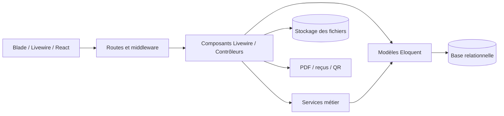
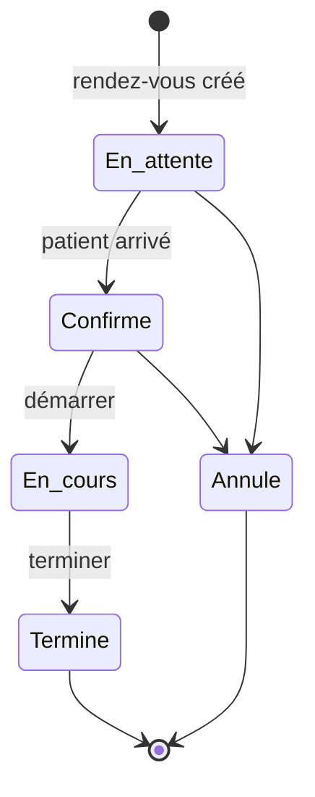
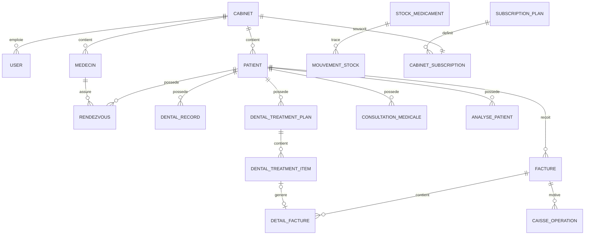
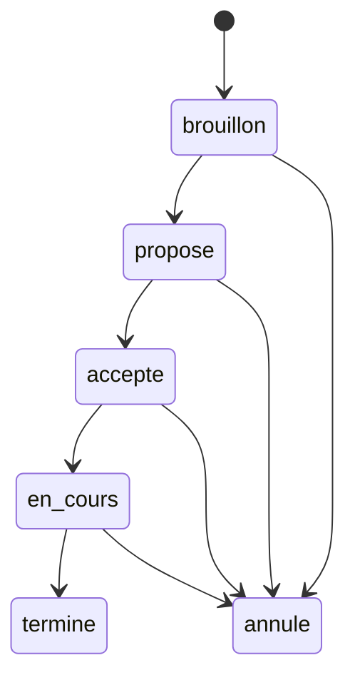
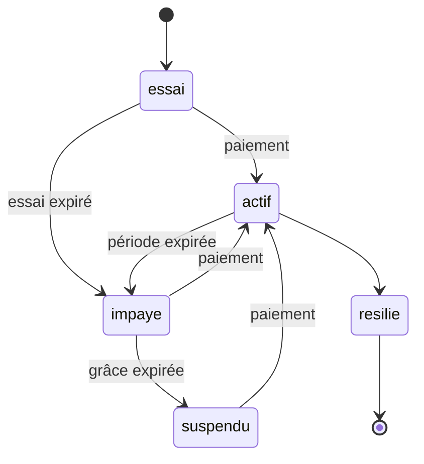

# Documentation fonctionnelle et technique de Sysdental

> État du code documenté : 4 novembre 2026  
> Application : Sysdental  
> Public visé : équipe produit, développeurs, testeurs, responsables de cabinet et intégrateurs.

## 1. Objet et portée

Ce document décrit le fonctionnement actuellement implémenté de l’application :

- architecture et composants logiciels ;
- rôles et autorisations ;
- parcours métier ;
- dossier odontologique et plan de traitement ;
- structures de données ;
- états et transitions ;
- règles de calcul ;
- facturation, caisse et pharmacie ;
- PWA et administration SaaS ;
- invariants de sécurité et limites connues.

Il s’agit d’une documentation de l’existant, et non d’une spécification médicale normative. La présence d’un diagnostic dans une liste ne constitue pas une validation clinique ou réglementaire du produit.

## 2. Vue d’ensemble du produit

Sysdental est une application SaaS multi-cabinet destinée à organiser le parcours d’un cabinet dentaire :

1. création ou recherche d’un patient ;
2. prise de rendez-vous ;
3. arrivée en salle d’attente ;
4. passage en salle de soins ;
5. examen odontologique ;
6. constitution d’un plan de traitement ;
7. transformation des soins prévus en devis ou facture ;
8. règlement patient et/ou assureur ;
9. suivi des pièces jointes, ordonnances, stocks et historique ;
10. pilotage financier et administration du cabinet.

L’application conserve également des modules médicaux généralistes hérités : constantes vitales, antécédents, consultation médicale, pharmacie et ordonnances. Ils servent de socle au dossier de santé, mais l’interface principale a été recentrée sur le dossier dentaire.

## 3. Architecture technique

### 3.1 Socle

| Couche | Technologie | Responsabilité |
|---|---|---|
| Serveur | PHP 8.1/8.2, Laravel 10 | routage, sécurité, accès aux données, PDF, services métier |
| Interface réactive | Livewire 2.12 | composants métier et interactions sans SPA complète |
| Interface locale | Blade, Tailwind CSS, Alpine.js | rendu, composants visuels, comportements simples |
| Odontogramme | React 18, `react-odontogram` | schéma anatomique interactif chargé à la demande |
| Données | Eloquent, base relationnelle | persistance multi-cabinet et relations métier |
| Documents | DomPDF, Simple QR Code | reçus, factures, ordonnances, QR patient |
| PWA | manifest, service worker | coque mobile, installation et page hors ligne sans données médicales |

### 3.2 Organisation logique



### 3.3 Styles d’interaction

- **Livewire** gère la majorité des formulaires et modales.
- **React** est isolé dans l’odontogramme et communique avec Laravel via les routes JSON d’état.
- **Événements Livewire** synchronisent les composants imbriqués : patient sélectionné, rendez-vous créé, dossier dentaire modifié.
- **Événements navigateur** ouvrent les reçus, notifient une mise à jour ou signalent une sauvegarde.
- Les écritures composées utilisent généralement une transaction SQL.

### 3.4 Dépendances principales

| Côté | Paquet | Version |
|---|---|---|
| PHP | `laravel/framework` | ^10.0 |
| PHP | `livewire/livewire` | ^2.12 |
| PHP | `laravel/sanctum` | ^3.3 |
| PHP | `barryvdh/laravel-dompdf` | ^3.1 |
| PHP | `simplesoftwareio/simple-qrcode` | ^4.2 |
| PHP | `doctrine/dbal` | ^3.9 |
| JS | `react`, `react-dom` | ^18.3 |
| JS | `react-odontogram` | ^0.6.0 |
| JS | `alpinejs` | ^3.14 |
| JS | `tailwindcss` | ^4.1 |
| Build | `laravel-mix` | ^6.0 |

Les ressources sont compilées par Laravel Mix (`webpack.mix.js`) : `resources/js/app.js` et `resources/js/react-odontogram.js` produisent les fichiers de `public/js`.

### 3.5 Installation et déploiement

Prérequis : PHP 8.1 ou 8.2, Composer, Node.js avec npm, et une base relationnelle (MySQL ou MariaDB).

```bash
composer install
cp .env.example .env
php artisan key:generate
```

Il faut ensuite renseigner dans `.env` au moins `APP_URL`, `DB_HOST`, `DB_PORT`, `DB_DATABASE`, `DB_USERNAME` et `DB_PASSWORD`. Les variables `MAIL_*` sont nécessaires seulement pour l’envoi de courriels. `SUBSCRIPTION_GRACE_DAYS` (5 par défaut, `config/subscription.php`) règle la période de grâce des abonnements.

```bash
php artisan migrate
php artisan db:seed
php artisan storage:link
npm install
npm run production
```

- `db:seed` exécute `DatabaseSeeder`, qui charge notamment `PermissionsSeeder` et `SubscriptionPlansSeeder`. Ces deux seeders sont indispensables au contrôle d’accès et aux offres SaaS.
- `storage:link` expose le disque public sur lequel sont stockées les pièces jointes. Leur consultation passe toutefois par `DentalAttachmentController` (§6.8).
- En développement, `npm run watch` recompile les ressources à chaque modification.
- En production, il faut aussi lancer `php artisan config:cache`, `route:cache` et `view:cache`, et mettre `APP_DEBUG=false`.

## 4. Multi-cabinet, authentification et autorisations

### 4.1 Principe de tenant

La plupart des données métier appartiennent à un cabinet identifié par `fkidCabinet` ou `fkidcabinet` selon les tables héritées.

Le trait `BelongsToTenant` :

- ajoute un scope global `TenantScope` ;
- filtre les requêtes sur le cabinet de l’utilisateur connecté ;
- remplit automatiquement la colonne de cabinet lors d’une création ;
- permet exceptionnellement `withoutTenant()` pour les opérations plateforme ou les exports contrôlés.

Les entrées sensibles sont également revalidées explicitement. Par exemple, un identifiant patient transmis au formulaire de rendez-vous doit encore être résolu dans le cabinet courant avant création.

### 4.2 Acteurs

| Acteur | Portée | Usage principal |
|---|---|---|
| Secrétaire | cabinet | patients, rendez-vous, salle d’attente, facturation courante |
| Médecin / dentiste | cabinet, ou ses seules données propres lorsqu’il ne dispose que des permissions `*.own` | soins, dossier dentaire, consultations, ordonnances |
| Propriétaire du cabinet | cabinet complet | administration, finances, utilisateurs, référentiels |
| Administrateur plateforme | tous les cabinets | plans SaaS, abonnements, suspension, export |

### 4.3 Permissions fonctionnelles

Les permissions sont regroupées par domaine :

- `rendez-vous.view/create/edit/delete/own` ;
- `salle-attente.view`, `salle-soins.view` ;
- `patient.view/create/edit/delete` ;
- `consultation.view/create/edit` ;
- `ordonnance.view/create` ;
- `dossier.view/print` ;
- `facture.view/view.own/create/edit/delete/ligne.delete` ;
- `finances.view/own/create/edit/delete`, `caisse-operations.view` ;
- `depenses.*`, `statistiques.view` ;
- `stock.view/edit`, `pharmacie.view/manage` ;
- `act.*`, `medecin.*`, `assureur.*`, `user.*`.

Les contrôles importants sont effectués à la fois sur la route et dans les méthodes Livewire mutantes.

## 5. Cartographie des composants

### 5.1 Accueil et orchestration

| Composant | Rôle |
|---|---|
| `AccueilPatient` | point d’entrée du cabinet, sélection patient, ouverture des modules, menus selon permissions, rappels et caches de référentiels |
| `PatientSearch` | recherche par nom, téléphone ou numéro de fiche, limitée au cabinet |
| `PatientManager` | création, modification, désactivation, suppression logique, historique dentaire et paiements |
| `ParametresCabinet` | identité visuelle, coordonnées, horaires et réglages du cabinet |

`AccueilPatient` agit comme un orchestrateur. Il conserve le patient courant et ouvre des composants spécialisés. Les caches des médecins, assureurs, actes et moyens de paiement sont préfixés par cabinet ; le cache des médecins peut aussi être individualisé par utilisateur.

### 5.2 Rendez-vous et circulation du patient

| Composant | Rôle |
|---|---|
| `CreateRendezVous` | création, recherche patient, choix praticien/date/heure, liste et modifications groupées |
| `RendezVousManager` | gestion générale des rendez-vous |
| `AgendaSemaine` | agenda mobile par semaine, jour actif et démarrage/fin de rendez-vous |
| `RdvReminders` | rendez-vous à rappeler et suivi des rappels |
| `SalleAttente` | patients arrivés, changements de statut, démarrage de consultation |
| `SalleSoins` | patients en cours de soins et fin de prise en charge |

### 5.3 Dossier clinique et odontologie

| Composant | Rôle |
|---|---|
| `DentalChartManager` | odontogramme structuré, sélection multiple, états dentaires, plan de traitement et transfert vers facture |
| `DossierMedicalManager` | historique, données médicales, consultations et fichiers joints |
| `ConsultationForm` | consultation facturable avec création coordonnée de facture, caisse, rendez-vous et fiche de traitement |
| `OrdonnanceManager` | ordonnances médicales, analyses et radiologie, lignes libres ou référentielles |
| `ActesPatient` | actes et soins associés au patient |
| `DentalOdontogramStateController` | lecture et sauvegarde du `payload` React de l’odontogramme |
| `DentalAttachmentController` | affichage et téléchargement protégés des pièces jointes |

### 5.4 Facturation, caisse et finances

| Composant | Rôle |
|---|---|
| `ReglementFacture` | factures patient, lignes d’actes/médicaments, paiements, remboursements et reçus |
| `CaisseOperationsManager` | recettes/dépenses de caisse, filtres et suppressions contrôlées |
| `DepensesManager` | saisie et gestion des dépenses |
| `HistoriquePaiement` | historique financier d’un patient |
| `StatistiquesManager` | recettes, dépenses et soldes par période, médecin et moyen de paiement |
| `MedecinPaiementStats` | indicateurs financiers par praticien |

### 5.5 Pharmacie et référentiels

| Composant | Rôle |
|---|---|
| `PharmacieManager` | entrées, ajustements, ventes, factures, mouvements et alertes de stock |
| `MedicamentManager` / `MedicamentSearch` | référentiel et recherche des médicaments |
| `ActeManager` / `ActeSearch` / `ListeActes` | catalogue des actes et tarifs de référence |
| `AssureurManager` | organismes et taux de prise en charge |
| `MedecinManager` | praticiens du cabinet |
| `TypePaiementManager` | moyens de paiement |

### 5.6 Administration

| Composant | Rôle |
|---|---|
| `UserManager` | utilisateurs du cabinet, activation, suppression et attribution de rôles |
| Contrôleurs `Admin/*` | cabinets, plans, abonnements, paiements SaaS et exports |
| `CabinetExportService` | archive des entités JSON et fichiers physiques du cabinet |
| `SubscriptionService` | essai, activation, impayé, grâce et suspension |

### 5.7 API de l’odontogramme

Trois routes web authentifiées, déclarées dans `routes/web.php`, sont servies par `DentalOdontogramStateController` :

| Méthode | URL | Nom de route | Rôle |
|---|---|---|---|
| GET | `/odontogramme/integre/{patient}` | `dental.odontogram.embed` | vue Blade qui intègre le composant React |
| GET | `/odontogramme/etat/{patient}` | `dental.odontogram.state.show` | lecture de l’état |
| PUT | `/odontogramme/etat/{patient}` | `dental.odontogram.state.update` | sauvegarde du `payload` |

**Contrôles.** Si le patient n’appartient pas au cabinet de l’utilisateur, la réponse est `404`. L’écriture exige `consultation.create`, faute de quoi la réponse est `403`. La vue intégrée reçoit `canEdit` selon cette même permission.

**Réponse de lecture (GET).**

```json
{
  "payload": { "...": "état propre à react-odontogram, ou null" },
  "records": {
    "16": {
      "status": "sain",
      "presence_status": "...",
      "restoration_status": "...",
      "endodontic_status": "...",
      "display_status": "carie",
      "surfaces": ["O"],
      "surface_statuses": { "O": "carie" },
      "clinical_findings": [],
      "orthodontic_findings": [],
      "diagnosis": null,
      "notes": null
    }
  },
  "updated_at": "2026-11-04T10:00:00+00:00"
}
```

`records` est indexé par numéro de dent FDI. `display_status` vaut `status` lorsque celui-ci n’est pas `sain`. Sinon, il prend le premier état de face trouvé parmi `carie`, `obturation` et `surveillance`, et retombe à `sain` s’il n’y en a aucun.

**Écriture (PUT).** Le corps doit contenir `{ "payload": { ... } }`, où `payload` est un tableau ou objet obligatoire, sinon la réponse est `422`. L’enregistrement se fait par `updateOrCreate` sur le couple cabinet/patient, et `updated_by` reçoit l’utilisateur courant. La réponse est `{ "saved": true, "updated_at": "..." }`. Cette route ne modifie jamais `dental_records` (§8.3).

## 6. Parcours fonctionnels

### 6.1 Création d’un patient

1. L’utilisateur ouvre la liste ou le formulaire rapide.
2. Il saisit identité, contacts, assurance et informations administratives.
3. La permission `patient.create` est vérifiée.
4. Le patient reçoit le `fkidcabinet` courant.
5. Le composant émet `patientCreated` et le patient peut devenir le patient actif.

La désactivation est distincte de la suppression logique. L’affichage des patients inactifs est optionnel.

### 6.2 Création rapide d’un rendez-vous mobile

1. L’agenda affiche le jour courant par défaut.
2. L’utilisateur choisit l’un des sept jours.
3. Le bouton **Nouveau RDV** transmet cette date à la page mobile compacte.
4. Le patient est recherché dans le cabinet.
5. Le praticien, l’heure, l’acte prévu et le statut sont saisis.
6. Le composant revalide le patient et le médecin dans le tenant courant.
7. Un conflit de créneau empêche l’écriture.
8. `OrdreRDV` est généré pour le jour et le praticien.
9. Le rendez-vous est créé et un reçu peut être ouvert.

Pour un utilisateur limité à `rendez-vous.own`, le praticien doit correspondre à son `fkidmedecin`.

### 6.3 Salle d’attente vers salle de soins



Le statut `Confirmé` signifie ici « patient arrivé au cabinet », et non « rendez-vous confirmé à l’avance ». `Terminé` et `Annulé` sont des états finaux. Le diagramme décrit le parcours nominal : l’annulation d’un rendez-vous `En cours` n’y est pas prévue.

Les libellés persistés sont principalement `En Attente`, `Confirmé`, `En cours`, `Terminé` et `Annulé`. Les comparaisons tolèrent encore certaines variantes historiques de casse.

Le démarrage :

- charge le rendez-vous dans le cabinet courant ;
- vérifie les permissions de modification ou de propriété ;
- marque le rendez-vous `En cours` ;
- ouvre explicitement le parcours de consultation sans terminer silencieusement une autre consultation.

### 6.4 Examen odontologique

1. Le patient actif ouvre le dossier dentaire.
2. L’odontogramme React est chargé à la demande.
3. Une ou plusieurs dents FDI sont sélectionnées.
4. L’utilisateur renseigne présence, restauration, endodontie, états par face, constatations, diagnostic et notes.
5. `DentalChartManager` valide toutes les valeurs contre les référentiels internes.
6. Chaque dent sélectionnée est enregistrée par `updateOrCreate` dans une transaction.
7. L’historique dentaire est rafraîchi.

### 6.5 De l’odontogramme au plan de traitement

1. La sélection courante de dents est reprise dans le formulaire du plan.
2. Un acte du catalogue peut préremplir le libellé et le prix.
3. L’utilisateur précise quantité, prix, description et dents.
4. Si aucun plan actif n’existe, un plan `brouillon` est créé.
5. Une ligne `prevu` est ajoutée.
6. Le total estimé du plan est recalculé.

### 6.6 Du plan au devis ou à la facture

- **Ajouter au devis** : crée ou réutilise une facture ouverte, ajoute une ligne de facture et passe la ligne du plan de `prevu` à `propose`.
- **Réalisé et facturer** : effectue la même liaison, puis marque la ligne `realise` avec `performed_at`.
- Une ligne déjà liée par `facture_detail_id` ne peut plus être supprimée depuis le plan.

### 6.7 Règlement

1. L’utilisateur sélectionne une facture.
2. Le système calcule le reste patient et, si assuré, le reste PEC.
3. Le payeur est choisi : patient ou organisme PEC.
4. Un montant positif produit une entrée ; un montant négatif produit un remboursement/sortie.
5. Une opération de caisse est créée.
6. `TotReglPatient` ou `ReglementPEC` est incrémenté.
7. Lorsque la facture est complètement payée, une vérification de sécurité s’assure que le stock médicament a été déduit.
8. Un reçu est proposé.

### 6.8 Fichiers joints

Les anciennes « analyses » sont présentées comme des fichiers joints. Elles peuvent représenter :

- radiographie ;
- scanner ;
- photographie ;
- PDF ;
- compte rendu ;
- biologie ou autre document clinique.

Les métadonnées sont dans `analyses_patient`, tandis que le fichier physique est stocké sur le disque public sous un chemin contrôlé. L’accès passe obligatoirement par un contrôleur authentifié et tenant-scopé, avec `Cache-Control: private, no-store`.

## 7. Modèle odontologique

### 7.1 Numérotation

La dentition permanente suit la notation FDI :

- arcade supérieure : `18` à `11`, puis `21` à `28` ;
- arcade inférieure : `48` à `41`, puis `31` à `38`.

### 7.2 Faces dentaires

| Code | Face |
|---|---|
| `O` | occlusale |
| `M` | mésiale |
| `D` | distale |
| `V` | vestibulaire |
| `L` | linguale ou palatine |

Chaque face possède son propre état : `sain`, `carie` ou `obturation`. `surfaces` contient uniquement les codes dont l’état n’est pas sain ; `surface_statuses` conserve la matrice complète.

### 7.3 État structuré d’une dent

L’état est séparé en axes indépendants :

| Axe | Valeurs principales |
|---|---|
| Présence | présente, absente, non éruptée, incluse, racine résiduelle, surnuméraire |
| Restauration/prothèse | aucune, couronne, facette, pilier de bridge, pontique, implant sans prothèse, couronne implanto-portée |
| Endodontie | non traitée, traitement antérieur, en cours, retraitement indiqué |
| Faces | sain, carie, obturation par face |
| Clinique | carie secondaire, fracture, usure, pulpite, nécrose, abcès, mobilité, parodontite, tartre, etc. |
| Orthodontie | rotation, version, ectopie, encombrement, diastème, supraclusion, classe d’Angle, etc. |

Le champ historique `status` demeure utilisé pour l’affichage synthétique. Il est dérivé dans l’ordre suivant :

1. dent absente → `absente`, sauf restauration implantaire → `implant` ;
2. restauration implantaire → `implant` ;
3. couronne, pilier ou pontique → `couronne` ;
4. endodontie différente de `non_traitee` → `endo` ;
5. sinon → `sain`.

Les caries et obturations par face restent portées par `surface_statuses`, même si le statut global est sain.

### 7.4 Constatations cliniques couvertes

Le référentiel actuel comprend notamment :

- carie secondaire, fissure, fracture ;
- attrition, abrasion, érosion, abfraction ;
- hypersensibilité, dyschromie, hypoplasie, fluorose ;
- pulpite, nécrose, lésion périapicale, abcès, fistule ;
- mobilité, résorption, ankylose ;
- gingivite, parodontite, récession, poche parodontale, tartre ;
- inclusion, agénésie et dent surnuméraire.

### 7.5 Constatations orthodontiques couvertes

- rotation, version/inclinaison ;
- ectopie ou inclusion orthodontique ;
- encombrement ou diastème ;
- supraclusion, infraclusion, articulé croisé, béance ;
- surplomb augmenté, déviation médiane ;
- classes d’Angle I, II et III.

Ces valeurs sont des constatations attachées à une dent. Une étude orthodontique complète de type céphalométrie, occlusion globale ou plan par phases nécessiterait des structures supplémentaires.

## 8. Structures de données principales

### 8.1 Relations métier



### 8.2 Dictionnaire synthétique

| Table / modèle | Clés et champs structurants | Rôle |
|---|---|---|
| `infocabinet` | `idEntete`, identité, statut, horaires, durée RDV | tenant/cabinet |
| `t_user` | utilisateur, rôle, cabinet, médecin associé | comptes du cabinet |
| `patients` | `ID`, identité, NNI, contacts, assurance, `fkidcabinet`, `deleted_at` | dossier administratif patient |
| `medecins` | `idMedecin`, nom, contact, cabinet | praticiens |
| `rendezvous` | patient, médecin, date, heure, ordre, statut, facture | agenda et file d’attente |
| `dossier_medical` | antécédents, groupe, allergies, maladies, traitements | données permanentes héritées |
| `consultation_medicale` | date, motif, constantes, diagnostic, prescriptions JSON | visites cliniques |
| `dental_records` | patient, dent FDI, états structurés, faces, constatations | dossier odontologique par dent |
| `dental_odontogram_states` | patient, `payload` JSON, auteur | état graphique React |
| `dental_treatment_plans` | référence, statut, total estimé, acceptation | plan de traitement |
| `dental_treatment_items` | dents, acte, quantité, prix, statut, lien facture | soins prévus/réalisés |
| `facture` | numéro, patient, totaux, PEC, règlements, médecin | en-tête facture/devis |
| `detailfacturepatient` | acte/médicament, quantité, prix, dent, type | lignes facturées |
| `caisse_operations` | entrée, sortie, paiement, facture, médecin | journal financier |
| `analyses_patient` | type, chemin, nom, MIME, taille, date | métadonnées des fichiers joints |
| `stock_medicaments` | quantité, seuil, prix achat/vente | stock agrégé par médicament/cabinet |
| `lots_medicaments` | lot, quantité restante, expiration | traçabilité des lots |
| `mouvements_stock` | entrée/sortie/ajustement, quantité, références | journal de stock |
| `subscription_plans` | prix, fonctionnalités, utilisateurs, stockage | offre SaaS |
| `cabinet_subscriptions` | statut, essai, période, grâce, suspension | abonnement d’un cabinet |
| `subscription_payments` | montant, moyen, mois, administrateur | paiements SaaS manuels |

### 8.3 Double persistance de l’odontogramme

Deux niveaux sont volontairement distincts :

- `dental_odontogram_states.payload` conserve l’état riche propre au composant React ;
- `dental_records` conserve les données cliniques structurées exploitables par Laravel, l’historique et la facturation.

Le `payload` ne doit pas devenir l’unique source métier : son format dépend de la bibliothèque graphique. Les données cliniques essentielles doivent rester normalisées dans `dental_records`.

## 9. Machines à états

### 9.1 Plan de traitement



Ce diagramme décrit le cycle de vie attendu. Les valeurs acceptées par le code sont : `brouillon`, `propose`, `accepte`, `en_cours`, `termine`, `annule`. Le passage à `accepte` renseigne `accepted_at`. Le code actuel valide les valeurs, mais n’impose pas l’ordre des transitions : toute valeur valide peut être enregistrée depuis n’importe quel état (voir §18.8).

### 9.2 Ligne de traitement

| État | Signification |
|---|---|
| `prevu` | soin ajouté au plan, sans devis |
| `propose` | soin lié à une ligne de devis/facture ouverte |
| `realise` | soin effectué, daté et facturé |

### 9.3 Abonnement SaaS



`resilie` est un état final. Les passages `impaye → resilie` et `suspendu → resilie` ne sont pas documentés ; reprendre le service après une résiliation exige un nouvel abonnement.

La période de grâce est configurable, avec 5 jours par défaut.

## 10. Règles de calcul

### 10.0 Devise

Tous les montants sont exprimés en ouguiya mauritanienne. Les vues et documents l’affichent principalement sous le code `MRU`. Quelques vues utilisent encore l’ancienne abréviation `UM`, qu’il faudrait uniformiser en `MRU`. Les montants ne portent pas de devise en base : l’application est mono-devise.

### 10.1 Taux de prise en charge

Les données historiques peuvent stocker `80` ou `0,8`. La normalisation est :

```text
taux = max(0, valeur)
si taux > 1 alors taux = taux / 100
taux = min(1, taux)
```

### 10.2 Répartition assurance/patient

```text
TotalPEC = MontantTotal × TauxPEC
PartPatient = MontantTotal − TotalPEC
```

La part patient s’obtient toujours par différence avec la part PEC, comme au §10.4. Ainsi, `TotalPEC + PartPatient = MontantTotal` reste exact malgré les arrondis. Aucune règle d’arrondi monétaire n’est encore définie (voir §18.8).

`ISTP = 1` si le taux est supérieur à zéro, sinon `0`.

### 10.3 Total d’un plan dentaire

```text
TotalEstimé = somme(QuantitéLigne × PrixUnitaireLigne)
```

Le total est recalculé après ajout ou suppression d’une ligne.

### 10.4 Ajout d’un soin au devis

```text
MontantLigne = Quantité × PrixUnitaire
NouveauTotalFacture = AncienTotalFacture + MontantLigne
NouveauTotalPEC = AncienTotalPEC + MontantLigne × TauxPEC
NouvellePartPatient = NouveauTotalFacture − NouveauTotalPEC
```

### 10.5 Reste à payer

Patient non assuré :

```text
RestePatient = TotFacture − TotReglPatient
FacturePayée si TotReglPatient >= TotFacture
```

Patient assuré :

```text
RestePatient = TotalfactPatient − TotReglPatient
RestePEC = TotalPEC − ReglementPEC
FacturePayée si RestePatient <= 0 ET RestePEC <= 0
```

Le formulaire initialise le règlement patient à `max(0, RestePatient)`.

### 10.6 Règlement, acompte et remboursement

- montant `< 0` : remboursement ; `retraitEspece = abs(montant)` ;
- montant `> reste patient` : il s’agit d’un trop-perçu, que le code actuel libelle à tort « acompte » (voir §18.8) ;
- autre montant positif : règlement ; `entreEspece = montant`.

Pour un assuré, le montant incrémente `ReglementPEC` si le payeur est `pec`, sinon `TotReglPatient`.

### 10.7 Numérotation des factures

Par cabinet et par année :

```text
numéro = préfixe numérique du dernier Nfacture(cabinet, année) + 1
nordre = dernier nordre(cabinet, année) + 1
Nfacture = numéro + "-" + année
```

Deux compteurs coexistent : `numéro` est relu dans le texte du dernier `Nfacture`, et `nordre` est une colonne entière qui sert au tri. Dans le cas normal, ils sont égaux. Ils peuvent diverger si un `Nfacture` a été saisi ou modifié manuellement. La première facture de l’année reçoit `1-AAAA`.

La génération utilise une transaction et `lockForUpdate`, avec au maximum dix tentatives en cas de collision.

### 10.8 Ordre de rendez-vous

L’ordre est le maximum existant pour le cabinet, la date et éventuellement le médecin, augmenté de 1. Le calcul est verrouillé en transaction.

### 10.9 Statistiques de caisse

```text
Recettes = somme(entreEspece)
Dépenses = somme(retraitEspece)
Solde = Recettes − Dépenses
```

Les mêmes agrégats sont calculés globalement, par moyen de paiement et par médecin.

### 10.10 Statistiques praticien

- recettes : somme de `PrixFacture × Quantite` des lignes du praticien ;
- dépenses : somme des retraits de caisse associés ;
- bilan : recettes − dépenses ;
- patients : nombre distinct de patients facturés ;
- actes : nombre de lignes ;
- montant moyen : moyenne de `PrixFacture × Quantite`.

### 10.11 Stock

Entrée :

```text
NouveauStock = AncienStock + QuantitéEntrée
ValeurMouvement = PrixAchatUnitaire × QuantitéEntrée
```

Vente :

```text
MontantLigne = Quantité × PrixFacturé
TotalPanier = somme(MontantLigne)
```

Alertes :

- stock faible si `quantiteStock <= quantiteMin` ;
- rupture si `quantiteStock <= 0` ;
- expiré si date passée et quantité restante positive ;
- expiration proche si la date est comprise entre aujourd’hui et aujourd’hui + 30 jours.

Valeur du stock :

```text
ValeurStock = somme(quantiteStock × prixAchat)
```

### 10.12 Quota de fichiers

```text
QuotaOctets = max_storage_mb × 1024 × 1024
Utilisé = somme(fichier_taille), suppressions logiques incluses
Disponible = max(0, QuotaOctets − Utilisé)
```

Un plan sans limite définie est considéré comme illimité.

### 10.13 Abonnement

Après paiement :

```text
Base = date la plus tardive parmi aujourd’hui, fin de période et fin d’essai
NouvelleFin = Base + nombre de mois couverts
Statut = actif
```

## 11. Ordonnances

Le module gère plusieurs catégories :

- ordonnance médicale ;
- analyses ;
- radiologie ;
- traitement d’urgence ;
- ordonnance de sortie selon l’interface.

Une ligne peut provenir du référentiel ou être saisie librement. Les ordonnances sont rattachées au patient et peuvent être imprimées ou téléchargées. Les ordonnances médicales peuvent inclure médicament, posologie, durée et quantité.

## 12. PWA et mobile

### 12.1 Routes mobiles

- `/mobile/agenda` ;
- `/mobile/rendez-vous/nouveau` ;
- `/mobile/salle-attente` ;
- `/mobile/salle-soins`.

La barre basse affiche les destinations autorisées par le rôle. L’agenda mobile montre un jour à la fois avec sept sélecteurs tactiles.

### 12.2 Installation et mises à jour

- manifest sous `/manifest.json` ;
- mode `standalone` ;
- orientation libre ;
- bouton d’installation contextuel Chromium ;
- aide « Sur l’écran d’accueil » sur iOS ;
- bannière lorsqu’un nouveau service worker est prêt ;
- rechargement après activation contrôlée.

### 12.3 Mode hors ligne

Le service worker met en cache uniquement la coque statique et la page hors ligne. Les réponses Livewire, API, dossiers, fichiers, radios et factures ne sont pas mises en cache. L’objectif est de ne jamais exposer de données médicales hors connexion.

## 13. Accès patient (hors périmètre)

L’accès direct des patients (portail par lien signé, connexion OTP, réservation en ligne, file d’attente publique) existe dans le code mais n’est pas utilisé actuellement. Il est volontairement exclu de cette documentation et ne fait pas partie du périmètre fonctionnel décrit.

## 14. Fichiers, PDF et exports

### 14.1 Documents produits

- reçu de consultation ;
- facture patient ;
- reçu de règlement ;
- ordonnance ;
- impression du dossier médical ;
- état journalier de caisse ;
- statistiques PDF ;
- export complet d’un cabinet.

### 14.2 Export cabinet

L’export produit une archive ZIP contenant :

- entités métier sérialisées en JSON ;
- fichiers physiques référencés par les pièces jointes ;
- données limitées au cabinet exporté.

Les exports financiers Excel du service `MedecinFinanceService` sont déclarés mais non implémentés.

## 15. Transactions et effets de bord

Les opérations suivantes doivent rester atomiques :

- création d’une consultation avec facture, détail, fiche de traitement, caisse et rendez-vous ;
- ajout d’un soin dentaire à une facture ;
- règlement et éventuelle déduction de stock ;
- vente pharmacie et lignes de facture ;
- mise à jour groupée de rendez-vous ;
- sauvegarde simultanée de plusieurs dents.

En cas d’erreur, la transaction est annulée et un toast d’erreur est émis. Les reçus ne sont ouverts qu’après succès.

## 16. Invariants métier et contrôles attendus

1. Toute donnée patient doit appartenir au cabinet courant.
2. Toute mutation doit revérifier la permission côté serveur.
3. Une dent doit appartenir à la liste FDI supportée.
4. Une face ou un état doit appartenir au référentiel fermé du composant.
5. Une ligne de plan déjà liée à une facture ne peut plus être supprimée depuis le plan.
6. Une quantité et un prix ne peuvent pas être négatifs ; la quantité d’un soin doit être au moins `0,01`.
7. Une vente ne peut dépasser le stock disponible.
8. Une facture doit recevoir un numéro unique dans son cabinet et son année.
9. Une pièce jointe ne doit jamais être servie directement sans contrôle du tenant.
10. Une suppression de facture doit restaurer le stock correspondant avant suppression logique.

## 17. Données supprimées et conservation

Les principales données de santé et financières utilisent `SoftDeletes` :

- patients ;
- dossiers et consultations ;
- pièces jointes ;
- ordonnances ;
- factures et certaines tables financières ;
- dossiers dentaires, plans et lignes de traitement.

Une suppression fonctionnelle n’efface donc pas immédiatement la ligne physique. Cette stratégie facilite l’audit et la restauration, mais elle implique que les quotas, exports et règles de conservation précisent explicitement s’ils incluent les données supprimées.

## 18. Points d’attention et dette fonctionnelle

### 18.1 Héritage de schéma

Le schéma combine des conventions anciennes (`IDPatient`, `fkidcabinet`, `Idfacture`, `IsAct`) et modernes. Les noms ne doivent pas être harmonisés sans migration de données et tests complets.

### 18.2 Statuts textuels

Certains anciens enregistrements utilisent des variantes de casse (`Terminé`/`terminé`). Une future normalisation devrait employer des constantes ou des enums en base.

### 18.3 Stock et commentaire FIFO

Plusieurs commentaires parlent de FIFO, mais certaines sorties réduisent directement le stock agrégé sans consommer précisément les lots par date d’expiration. Une vraie stratégie FIFO/FEFO nécessite de diminuer `quantiteRestante` lot par lot.

### 18.4 Consultation immédiatement réglée

Le parcours `ConsultationForm` initialise actuellement `TotReglPatient` à la part patient et crée immédiatement une entrée de caisse. Il représente donc une consultation payée à la création, contrairement au parcours devis/facture qui peut rester ouvert.

### 18.5 Référentiels globaux ou tenant

Les actes, assureurs et médicaments sont encore issus d’un historique où certains référentiels peuvent être globaux. Leur propriété définitive — plateforme ou cabinet — doit être décidée avant toute généralisation du scope tenant.

### 18.6 Orthodontie

Les constatations orthodontiques par dent sont présentes. Il manque encore, pour un dossier orthodontique spécialisé complet :

- analyse occlusale globale structurée ;
- mesures céphalométriques ;
- photographies standardisées ;
- phases thérapeutiques et appareils ;
- suivi des activations et contention.

### 18.7 Journal d’audit

Les timestamps, auteurs et mouvements couvrent partiellement la traçabilité. Un journal d’audit transverse et immuable des consultations, permissions, exports et suppressions reste recommandé.

### 18.8 Incohérences connues du code

- Un règlement supérieur au reste à payer est libellé « acompte », alors qu’il s’agit d’un trop-perçu.
- L’ordre des transitions du plan de traitement n’est pas contrôlé.
- Aucune règle d’arrondi monétaire n’est définie pour la répartition PEC/patient.
- La durée de conservation et la purge des données supprimées logiquement ne sont pas définies.

## 19. Stratégie de tests

Les tests importants doivent couvrir :

- utilisateur sans permission ;
- cabinet A tentant d’accéder aux données du cabinet B ;
- création et transitions nominales ;
- conflits de rendez-vous ;
- calculs patient/PEC ;
- paiement partiel, complet et remboursement ;
- restauration du stock lors d’une suppression ;
- quota de fichiers et export physique ;
- rendu mobile et actions tactiles essentielles.

Tests existants, lancés avec `php artisan test` :

| Domaine | Fichiers (`tests/`) |
|---|---|
| Isolation tenant | `Feature/TenantIsolationTest.php`, `Feature/DocumentPrintTenantIsolationTest.php`, `Feature/AccueilPatientCacheIsolationTest.php` |
| Autorisations | `Feature/CatalogManagerAuthorizationTest.php`, `Feature/PatientManagerAuthorizationTest.php`, `Feature/UserManagerAuthorizationTest.php`, `Feature/CreateRendezVousAuthorizationTest.php` |
| Patients | `Feature/PatientSoftDeleteTest.php` |
| Agenda et circulation | `Feature/AgendaSemaineTest.php`, `Feature/SalleAttenteSoinsMobileModeTest.php`, `Feature/RdvRemindersReminderTrackingTest.php` |
| Dentaire | `Feature/DentalChartManagerTest.php` |
| Facturation et stock | `Feature/FactureNumberingTest.php`, `Feature/ReglementTest.php`, `Feature/StockDeductionTest.php` |
| SaaS et fichiers | `Feature/SubscriptionTest.php`, `Feature/PlatformAdminTest.php`, `Feature/StorageQuotaAndExportTest.php` |
| Divers | `Feature/ParametresCabinetTest.php`, `Feature/AccueilPatientToastTest.php`, `Feature/WhatsAppServiceTest.php` |

D’autres tests de composants se trouvent dans `tests/Feature/Components` et `tests/Feature/Livewire`.

## 20. Glossaire

| Terme | Définition dans l’application |
|---|---|
| Acte | prestation tarifable issue du catalogue |
| Soin prévu | ligne du plan non encore réalisée |
| Devis | facture ouverte recevant des soins proposés |
| PEC | prise en charge par un assureur |
| ISTP | indicateur de tiers payant/assurance dans la facture |
| Odontogramme | représentation graphique et structurée de l’état dentaire |
| Face | surface d’une dent : O, M, D, V ou L |
| Plan de traitement | ensemble ordonné de soins proposés au patient |
| Fichier joint | radio, scanner, image, PDF, analyse ou compte rendu |
| Tenant | cabinet propriétaire et périmètre d’isolation d’une donnée |
| PWA | application web installable avec coque mobile et service worker |

## 21. Références principales dans le code

- `app/Http/Livewire/AccueilPatient.php`
- `app/Http/Livewire/DentalChartManager.php`
- `app/Http/Livewire/CreateRendezVous.php`
- `app/Http/Livewire/ConsultationForm.php`
- `app/Http/Livewire/ReglementFacture.php`
- `app/Http/Livewire/PharmacieManager.php`
- `app/Http/Livewire/DossierMedicalManager.php`
- `app/Models/Facture.php`
- `app/Models/Concerns/BelongsToTenant.php`
- `app/Services/SubscriptionService.php`
- `database/seeders/PermissionsSeeder.php`
- `database/migrations/2026_10_19_000001_create_dental_care_tables.php`
- `routes/web.php`

